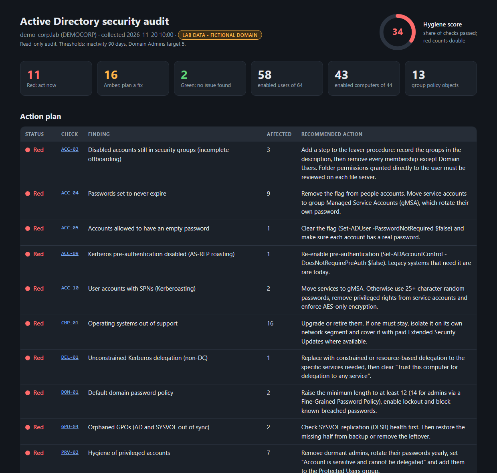

# AD Security Audit

[](https://github.com/ImSothe/AD-Security-Audit/actions/workflows/ci.yml)


A read-only security and hygiene audit for an Active Directory domain, in PowerShell. It reads the directory, runs 29 checks and writes **one HTML report you can email to management**. Each check gets a traffic light (red, amber or green), and every problem comes with the action that fixes it.

> **Built with AI assistance (Claude Code).** I chose what to audit based on what I see as an IT technician, reviewed every check and its thresholds, and tested the tool end to end against the lab domain and [a real production domain](#real-world-run). The tool never writes anything. It only uses `Get-*` cmdlets, and a test fails the build if a write cmdlet appears in the collector.

**Try it without Active Directory:** run `.\Invoke-ADSecurityAudit.ps1 -Lab` on any Windows PC, or download [docs/sample-report.html](docs/sample-report.html) and open it in a browser.



## Why it exists

Small and medium-sized domains tend to collect the same problems over the years. Nobody notices them because nothing breaks:

- people who left but whose accounts are still enabled, or disabled but still in every group they had
- accounts created "for testing" or for a supplier that nobody ever used
- service accounts whose passwords never expire and have not changed in years
- more Domain Admins than anyone can explain, including former staff and external IT companies
- Windows 7 and Windows 10 PCs, and a 2012 R2 server nobody wants to touch
- GPOs that apply to nobody, or exist only half in AD and half in SYSVOL

Each one is quick to find by hand if you know the right command, but it is tedious to do them all and harder still to explain the results to someone who is not technical. So the goal was:

- **One command that checks everything and changes nothing.** It has to be safe to run on a production domain.
- **A report a manager can read:** a colour per check, a number of affected objects and what to do about it.
- **Proof that it works without a domain.** A lab mode with a fictional company, so anyone can try it.

## What it checks

| ID | Check | Red when | Amber when |
|---|---|---|---|
| **Account hygiene** ||||
| ACC-01 | Enabled users inactive for more than 90 days | more than 10% of users | any |
| ACC-02 | Ghost accounts: enabled, never logged on, created over 30 days ago | | any |
| ACC-03 | Disabled accounts still in security groups (incomplete offboarding) | one is still in a privileged group | any |
| ACC-04 | Passwords set to never expire | a privileged account has it | any |
| ACC-05 | `PasswordNotRequired` (an empty password is allowed) | any | |
| ACC-06 | Passwords older than one year | | any |
| ACC-07 | Enabled accounts that are locked out or past their expiry date | | any |
| ACC-08 | Reversible password encryption | any, or enabled in the domain policy | |
| ACC-09 | Kerberos pre-authentication disabled (AS-REP roasting) | any | |
| ACC-10 | User accounts with SPNs (Kerberoasting) | a privileged account has one | any |
| ACC-11 | Built-in Guest account enabled | enabled | |
| **Privileged access** ||||
| PRV-01 | Inventory of Domain Admins, Enterprise Admins and Administrators, including nested members | Domain Admins count is more than 2× the target | Domain Admins count is above the target |
| PRV-02 | Members in groups that should be empty (Enterprise and Schema Admins, Operators groups) | | any |
| PRV-03 | Weak privileged accounts: dormant, disabled but still members, password never expires or older than a year, can be delegated | a dormant admin | any |
| PRV-04 | krbtgt password age | more than 365 days | more than 180 days |
| PRV-05 | Built-in Administrator (RID 500) password age | | more than 365 days |
| PRV-06 | Former admins still flagged `adminCount=1` | | any |
| **Delegation** ||||
| DEL-01 | Unconstrained delegation on accounts that are not domain controllers | any | |
| DEL-02 | Constrained delegation with protocol transition | | any |
| DEL-03 | Resource-based constrained delegation | | any |
| **Computers** ||||
| CMP-01 | OS past end of support (Windows 7/8.1/10, old Windows 11 releases, Server 2008/2012) or ending within 12 months (Server 2016) | past end of support | ending within 12 months |
| CMP-02 | Computers inactive for more than 90 days | | any |
| **Group Policy** ||||
| GPO-01 | GPOs not linked anywhere (or only through disabled links) | | any |
| GPO-02 | GPOs with all settings disabled | | any |
| GPO-03 | Empty GPOs (never edited) | | any |
| GPO-04 | Orphaned GPOs: in AD without a SYSVOL folder, or in SYSVOL without an AD object | any | |
| **Domain** ||||
| DOM-01 | Default password policy: length, complexity, lockout, history, reversible encryption | length below 8 or reversible encryption | below the targets |
| DOM-02 | Domain functional level | | below 2016 |
| DOM-03 | AD Recycle Bin | | disabled |

The report opens with an **action plan**: every red and amber finding with its recommended action, for example *"Check with HR or the account owner, then disable the account and move it to a leavers OU"*. Below it, each check expands to show the affected accounts, computers or GPOs.

The **hygiene score** is the share of checks that pass, with red counting twice as much as amber (all green = 100). It is meant for comparing one audit with the next. It is not a benchmark.

## Quick start

```powershell
# Lab mode: fictional "Demo Corp" domain, works on any Windows PC
.\Invoke-ADSecurityAudit.ps1 -Lab

# The current domain, from a domain-joined machine with RSAT
.\Invoke-ADSecurityAudit.ps1

# Stricter inactivity threshold, a specific DC, custom output folder
.\Invoke-ADSecurityAudit.ps1 -InactiveDays 60 -Server dc01.example.local -OutputDirectory C:\Audits

# Collect on a DC, analyse somewhere else
.\Invoke-ADSecurityAudit.ps1 -ExportSnapshot                                   # on the DC
.\Invoke-ADSecurityAudit.ps1 -SnapshotPath .\ad-audit-CORP-...-snapshot.json    # anywhere
```

| Parameter | Meaning |
|---|---|
| `-Lab` | Use the fictional domain in `lab/lab-sample.json`. |
| `-SnapshotPath` | Analyse a snapshot saved earlier with `-ExportSnapshot`. |
| `-Server`, `-Credential` | Domain controller and account used to read AD (default: current domain and user). |
| `-InactiveDays` | Days without logon before an account counts as inactive (default 90). |
| `-MaxDomainAdmins` | Acceptable Domain Admins count. More than this is amber; more than twice this is red (default 5). |
| `-OutputDirectory` | Where the results and the report are written (default `.\reports`). |
| `-ExportSnapshot` | Also save the raw collected data as JSON. |
| `-PassThru` | Return the results object to the pipeline. |

Full help: `Get-Help .\Invoke-ADSecurityAudit.ps1 -Full`.

Each run writes two files:

| File | Contents |
|---|---|
| `ad-audit-<DOMAIN>-<date>-results.json` | Every finding with its affected objects. Use it for automation or to compare runs over time. |
| `ad-audit-<DOMAIN>-<date>-report.html` | The executive report. It is one self-contained file with no external fonts, scripts or images, and it works offline, prints cleanly and follows the system's light or dark mode. |

## Requirements

- Windows PowerShell 5.1 or PowerShell 7.
- **For a real domain:**
  - The RSAT **ActiveDirectory** module. It is already on domain controllers; on Windows 10/11, install it from *Settings > Optional features > RSAT: Active Directory Domain Services*.
  - Any domain account. A normal user can read almost everything checked here.
  - Read access to `\\<domain>\SYSVOL`, for the orphaned-GPO check.
- **For lab mode:** nothing else.

## How it works

```
 Collect (Get-* only)  ->  snapshot  ->  checks  ->  results.json  ->  HTML report
 src/Collect.ps1           or lab/       src/        (data)            ConvertTo-ADAuditReport.ps1
                           lab-sample    Checks.ps1                    src/Report.ps1
```

1. **Collect.** The script reads the following, using `Get-*` cmdlets only:
   - users and computers with their security-relevant attributes
   - the effective members of the privileged groups (`Get-ADGroupMember -Recursive`)
   - every GPO container and every `gPLink` in the domain and its sites
   - the domain password policy, functional levels and Recycle Bin state

   The result is a plain *snapshot* object.
2. **Analyse.** Each check is a function that takes the snapshot and returns a finding: severity, affected objects and recommended action. Checks never talk to AD. This is why the same code runs against a live domain, a saved snapshot or the lab, and why it can be tested.
3. **Report.** The results are saved as JSON. `ConvertTo-ADAuditReport.ps1` turns that JSON into HTML and never touches AD, so you can rebuild the report on any machine:

   ```powershell
   .\ConvertTo-ADAuditReport.ps1 -InputPath .\reports\ad-audit-CORP-20261120-1000-results.json
   ```

### Design choices

- **Language-independent.** Privileged groups are found by their well-known SID (`-512`, `-519`, `S-1-5-32-544`...), not by name, so localized domains work. For example, Spanish domains call Domain Admins *Admins. del dominio*.
- **No GroupPolicy module needed.** GPOs are read from their AD containers and `gPLink` attributes. Link state and version numbers are decoded directly, and SYSVOL is checked with `Test-Path`.
- **OS support by build, not only by name.**
  - **Windows 11:** each release has its own end date, and Enterprise/Education get a year more than Home/Pro, so the build number (`OperatingSystemVersion`) decides. Only releases already out of support are flagged, because the current one always ends within a year and moves on through Windows Update.
  - **Windows 10 LTSC:** AD reports the same name for every LTSC release, so the build picks the right date (2019 runs until 2029, for example). These machines are not flagged together with the rest of Windows 10.
- **`LastLogonDate`, not `LastLogon`.** `LastLogonDate` is replicated, so asking one DC is enough. It can lag by up to 14 days, which does not matter for a 90-day threshold.
- **Fails visibly.** If a data source cannot be read, its checks show *Not run* in grey instead of a misleading green.

## Security

An audit tool runs with access to sensitive data and its output travels by email, so it gets the same scrutiny as the domain it audits.

| Guarantee | How it is enforced | Tested by |
|---|---|---|
| **Read-only** | The collector only calls `Get-*` AD cmdlets. | The PowerShell parser lists every command the collector invokes, and a fake AD module records each call at run time; both fail on anything that is not `Get-*`. |
| **No secrets collected** | Every property is mapped explicitly; nothing is copied wholesale. | The fake AD returns LAPS passwords and hashes; the test proves they never reach the snapshot. Another test fails if the collector requests a secret attribute (`unicodePwd`, `ms-Mcs-AdmPwd`, `msLAPS-*`, `msDS-ManagedPassword`, BitLocker keys). |
| **Credentials never stored** | `-Credential` is only passed to AD cmdlets. | The snapshot JSON is checked for the user name and password of the credential used. |
| **No script injection in the report** | Every value is HTML-encoded. A strict Content Security Policy (`default-src 'none'`) allows only the report's own script, pinned by its SHA-256 hash, and there are no inline event handlers. | An XSS payload is placed in every directory string field (names, groups, SPNs, GPOs, OS, domain); the report must render it as text and contain exactly one script. The CSP hash is recomputed and compared. |
| **Tampered results files are harmless** | The report treats the results JSON as untrusted: severities are whitelisted, numbers re-parsed, totals recounted. | Injection through severity, counts, totals, score, columns and version. |
| **No path traversal** | Output file names are built from a sanitised NetBIOS name. | A snapshot with `..\..\` in the domain name must write only inside the output folder. |
| **No network or dynamic code** | No downloads, web requests, remoting, `Invoke-Expression`, `Add-Type` or `Start-Process`. Files are written only by the entry script. | Parser-based checks over every shipped script. |
| **Static analysis** | PSScriptAnalyzer security rules and all Error-level rules. | Separate CI job. |
| **Repository hygiene** | Real output is git-ignored. | Tests check that tracked files contain no e-mail addresses, user profile paths, private keys or secret-looking values, and that report and snapshot files are ignored. |

The tests were themselves checked by **mutation testing**: 8 realistic bugs were injected one at a time, and every one made the suite fail. The bugs were:

- HTML encoding removed
- severity whitelist removed
- a write cmdlet added to the collector
- a LAPS attribute requested
- an off-by-one in the inactivity threshold
- domain controllers no longer excluded from the delegation check
- the output file name no longer sanitised
- the CSP removed

## Lab mode

`lab/lab-sample.json` describes *Demo Corp* (`demo-corp.lab`), a fictional company with 64 users, 44 computers and 13 GPOs. It has the problems you find in real small businesses:

- an external IT supplier that is still a Domain Admin after 214 days without logging on
- a former admin who was disabled but is still in Domain Admins
- service accounts with passwords several years old, one of them in Domain Admins with an SPN
- Windows 7, Windows 10 and outdated Windows 11 PCs
- a 2012 R2 server with unconstrained delegation
- a "GPO test" that nobody deleted

It also has things that must *not* be flagged, such as a Windows 10 LTSC kiosk that is still supported and domain controllers with their normal delegation.

All names are invented. `tools/New-LabSample.ps1` builds the file from `src/Lab.ps1` with fixed values, so every run produces the same file, and refreshes the sample report. A test fails if the committed file no longer matches the generator.

## Real-world run

The tool has been run read-only against a live production domain at a small company. All 29 checks completed and none was left as *Not run*, so every data source the checks need was read (users, computers, privileged groups, GPO containers, SYSVOL and the domain policy), and nothing was changed in the directory.

The report was turned into an improvement plan for management, with one rule: **no disruption for staff**. The findings of that run stay private, because a list of a real company's weaknesses is exactly what should never be published.

## Tested

**146 automated tests** with no external dependencies (Pester is not needed). CI runs them on Windows PowerShell 5.1 and PowerShell 7, builds the lab report end to end and runs PSScriptAnalyzer.

```powershell
powershell -ExecutionPolicy Bypass -File .\tests\Run-Tests.ps1                    # everything
powershell -ExecutionPolicy Bypass -File .\tests\Run-Tests.ps1 -Filter Security   # one area
```

| File | Tests | What it covers |
|---|---|---|
| [Checks.Tests.ps1](tests/Checks.Tests.ps1) | 52 | Every check on small hand-built domains. Covers thresholds and their exact boundaries (90/91 days, 180/181 and 365/366 for krbtgt, 5/6/10/11 Domain Admins), exclusions (disabled accounts, DCs, krbtgt) and renamed built-in accounts found by RID. Also covers OS lifecycle by name, build and edition, password policy rules, functional levels, scoring and *Not run* handling. A healthy domain must come out all green, and checks must not modify their input. |
| [Lab.Tests.ps1](tests/Lab.Tests.ps1) | 39 | Exact severity and count of all 29 checks on the lab domain, planted weaknesses found by name, and things that must not be flagged. Also checks that the committed lab file matches its generator. |
| [Security.Tests.ps1](tests/Security.Tests.ps1) | 18 | See [Security](#security). |
| [Collect.Tests.ps1](tests/Collect.Tests.ps1) | 15 | The collector against a fake AD module: field mapping, DC and RODC detection, localized group names, recursive membership, forest-root groups, GPO link and version decoding, SYSVOL orphans, partial failures, and `-Server`/`-Credential` reaching every call. |
| [Report.Tests.ps1](tests/Report.Tests.ps1) | 13 | Report structure: anchors, action-plan order, open red sections, balanced tags, truncation, warnings, UTF-8 without BOM, and accented names. |
| [Cli.Tests.ps1](tests/Cli.Tests.ps1) | 9 | The scripts end to end: output files, `-PassThru`, thresholds, parameter validation, full help, clean parsing and ASCII-only sources (Windows PowerShell 5.1 misreads UTF-8 without BOM). |

- **Lab and snapshot modes** were run end to end, and I reviewed the report in a browser.
- **Run against a real production domain.** All 29 checks completed and none was left as *Not run*; see [Real-world run](#real-world-run). The collector tests still use a fake AD module, so CI does not need a domain. If something fails on yours, please open an issue with the error message.

## Good to know

- **Treat the output as confidential.** The report, results JSON and snapshot list account names, group memberships and the domain's weak points. `reports/` and `*-snapshot.json` are git-ignored. Do not publish real output.
- **Thresholds are a starting point.** 90 days of inactivity and 5 Domain Admins are common baselines; adjust them with `-InactiveDays` and `-MaxDomainAdmins` to your policy.
- **Not checked:** file share permissions granted directly to a user, and per-DC `LastLogon` values. The ACC-03 recommendation reminds you to review shares on each file server.
- **Easy to extend:** a new check is one function that takes the context and returns `New-AuditFinding`. Add it to the list in `Invoke-ADAuditChecks` and add a test.

## Troubleshooting

| Symptom | Likely cause |
|---|---|
| `The ActiveDirectory module (RSAT) is not installed` | Install RSAT AD DS tools, run on a DC, or use `-Lab`. |
| Group Policy checks show *Not run* | The account cannot read the policies container or SYSVOL. See *Collection warnings* at the bottom of the report. |
| A privileged group is missing from the inventory | The group does not exist at your schema level (for example Key Admins before Server 2016), or the forest root domain could not be reached for Enterprise/Schema Admins. |
| An active user shows as inactive | `LastLogonDate` replication lag (up to 14 days) or a user who only signs in to cloud services. Check `LastLogon` on each DC before disabling. |

## License

MIT. See [LICENSE](LICENSE).
